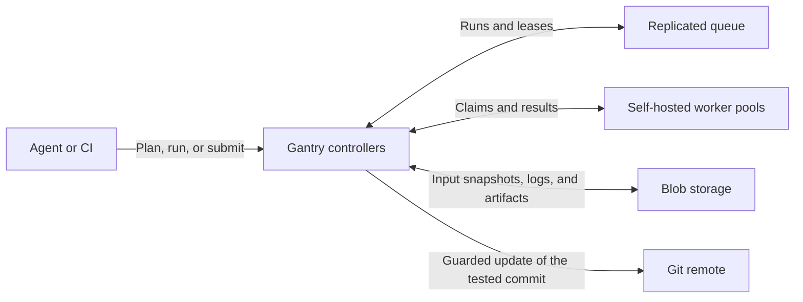

# Gantry

**Self-hosted builds and tested merges for coding agents.**

Give an agent a Git commit and a build target. Gantry returns a plan the agent
can inspect, runs the work on your hardware, and gives back a durable run ID
with per-action status, logs, and artifacts. When several changes are ready,
Gantry builds their combined commit and lands that exact commit if it passes
and the target branch still matches the tested base.

[Try it locally](#get-started) · [Integrate a repository](docs/integrating.md) ·
[Run a worker pool](docs/running.md) · [CLI](docs/cli.md) ·
[HTTP API](docs/api.md) · [Architecture](docs/architecture/runtime.md) ·
[Tour of the code](docs/guide/tour.md)

## Why Gantry

| Feature | What it gives you |
| --- | --- |
| **An API agents can use directly** | Preview the action graph, start a run with a caller-chosen ID, and pick it up in another session. JSON status identifies failed actions and points to their logs and artifacts. A separate, restricted action lets an agent investigate a specific failure. |
| **One queue across projects** | Register multiple repositories and route their work to named pools. Add workers on the machines you want to use. A quorum of controllers shares the queue, so a worker can reach another controller when one goes down. |
| **Work that survives unrelated edits** | Each action declares its own inputs and outputs. Gantry can reuse a result when its input bytes, upstream output bytes, image, and action definition match, even across different commits. Call your existing build tools from an action. |
| **The tested commit is the merge** | Submit an ordered group of PRs and test them together. Gantry advances the target to the candidate it tested with a Git ref update guarded by the expected base. If the branch moves, the group needs to be tested against the new base. |

Gantry runs builds on its own workers. Use plain Git and the HTTP API, or add
the optional GitHub Actions workflow to submit groups and link the landed
commit on the original PRs. [GitHub integration](docs/integrating.md#submit-an-ordered-group)

## Get started

On Linux, install the toolchain and Docker prerequisites, then build and
install the bundled release. [Runbook](docs/running.md#build-and-verify)

```sh
git clone https://github.com/Roasbeef/gantry.git
cd gantry
make install PREFIX="$HOME/.local"
export PATH="$HOME/.local/bin:$PATH"
gantry init --local
```

Init creates a private profile, runs a Docker smoke build, and reports its
run ID and artifact digest. The installed `gantry` CLI, onboarding
included, runs on the bundled BEAM runtime and needs no jq, curl, or
OpenSSL. Use `gantry local start` to keep the local
services running, and `gantry skill` to give an agent the CLI instructions.
[Local and remote setup](docs/running.md#verify-a-local-installation)

`make e2e` runs the contributor fixture with three controllers, a Docker
worker, and a bare Git remote. It exercises controller loss, receipt
replay, build reuse, and the guarded branch update.

## Run your first build

Commit a `gantry.json` at the root of your project. This example wraps an
existing `make check` target. Give the worker image the project's toolchain
and dependencies so the command can run offline.

```json
{
  "targets": {"check": ["verify"]},
  "actions": [
    {
      "name": "verify",
      "argv": ["make", "check"],
      "inputs": ["."],
      "outputs": [],
      "timeout": 900
    }
  ]
}
```

Register the repository, target, image digest, and worker pool on the
controller. From your project checkout, use a commit available on the
registered remote. Set `GANTRY_URL` and `GANTRY_TOKEN` for the controller.

```sh
# The installed `gantry`, or the source shim, which needs Gleam and Erlang.
gantry=/path/to/gantry/scripts/gantry
revision=$(git rev-parse HEAD)
run_id="check-$(date +%s)"

"$gantry" plan "$run_id" owner/project "$revision" check
"$gantry" run "$run_id" owner/project "$revision" check
"$gantry" watch "$run_id"
```

Run `gantry describe run` with the installed CLI to inspect the request
schema, inputs, and defaults without a controller connection.
[CLI discovery and examples](docs/cli.md#discover-commands)

An agent can save the run ID and use `status` or `watch` after reconnecting.
Use `blob <sha256>` to fetch a log or artifact from the result. Split a
check into actions with narrow inputs to get finer-grained reuse.
[Setup and submission walkthrough](docs/integrating.md) ·
[Example with an artifact dependency](docs/examples/gantry.json)

## How it works



A pure Gleam core decides graph and queue transitions. Controllers persist those
decisions through Khepri and Ra before dispatching effects. Workers keep a local
journal so they can recover assignments and replay results after a restart.
[Runtime architecture](docs/architecture/runtime.md) ·
[Tour of the code](docs/guide/tour.md)

Run more workers by adding slots to a named pool. Each slot runs one action at
a time and can reach every controller in its queue's quorum through the HTTPS
API. A single action never splits across slots, so a repository's parallelism
comes from how its manifest is cut into actions.
[How work is spread](docs/scheduling.md) ·
[Add a machine](docs/operations.md#add-a-machine) ·
[Controller and worker setup](docs/running.md#choose-a-deployment)

## Project status

The current release scope covers pinned Git commits, declared and ad hoc
actions, Docker execution, and ordered group submission. The live harness
exercises the queue, Docker, and Git path against a local bare remote, and a
GitHub pilot has landed a group on a disposable branch. What is built, what is
open, and the throughput measured so far are in one place:
[status](docs/architecture/runtime.md#status).

Gantry uses a TLA+ model to check queue invariants and seeded deterministic
simulation to exercise retries, controller loss, lease expiry, and delayed
effects. See the runbook for the model, unit, and live end-to-end commands.
[Verification model](protocol/models/queue/README.md) ·
[Queue verification](docs/queue-verification.md) ·
[Operations and recovery](docs/operations.md) ·
[Target design](docs/architecture/build-and-submit.md) ·
[Contributor handoff](docs/next.md) ·
[Performance workflow](skills/gantry-perf/SKILL.md)
