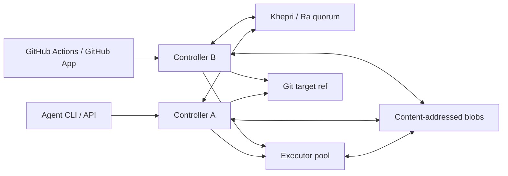

# Build and submit architecture

**Status** · Proposed · 2026-11-21

Gantry needs to answer two questions after losing a controller. Which work
can another controller finish, and which externally visible effects might
already have happened? The controller commits the decision and its identity
before calling an executor or Git. Those external systems enforce their own
conditions. The controller records the outcome before telling the caller
that the effect is complete.

## The graph an agent can inspect

A repository declares targets and actions in a versioned manifest. A target
names the terminal actions to satisfy. An action declares argv, working
directory, input paths and upstream outputs, output paths, environment,
a pinned toolchain, platform and isolation requirements, resource needs,
and a timeout. The compiler resolves paths in a snapshot, rejects cycles
and overlapping outputs, and exposes the action closure in stable order.
Dependencies that supply bytes participate in identity. Ordering-only
dependencies constrain scheduling.

A build references a Git commit, with a separately digested overlay when
an agent wants to test before committing. Actions receive a projected tree
and upstream artifacts. The submit plan and required targets come from the
configured policy at the protected base. The candidate supplies code to
build. An agent can test a proposed manifest change without giving that
manifest authority to remove a required submit target.

The action key hashes a versioned canonical encoding of the normalized
action, its declared input tree and upstream output digests, and the
toolchain and execution policy identities. The run records the entire
source snapshot as provenance. This lets an unrelated edit reuse an action
whose inputs are identical. A legacy command that can inspect the entire
checkout declares the entire tree as input. If an action observes Git
metadata, those values go in its inputs and key. An ad hoc action receives
a restricted policy and a run-local scope. Its result cannot satisfy a
required submit action or publish into that action's cache namespace.

Store content by digest with verified lengths and bytes. Scope reads and
cache publication by project and trust policy. Only publish success after
the active attempt has reported all required outputs and their manifests are
durable. A hash establishes which bytes were stored. Submit eligibility
also requires provenance from an approved executor and policy.

| Agent operation | Result the caller can act on |
| --- | --- |
| Plan target | Dependency closure, declared inputs, resource class, and possible cache reuse |
| Start / watch | Idempotent request key, run and action IDs, and ordered lifecycle events with a resumable cursor |
| Inspect failure | Failed action and attempt, exit or infrastructure reason, blocked dependents, log ranges, artifact digests, and reproduction parameters |
| Retry / cancel | A new attempt or run with explicit lineage, or a durable cancellation state with any running work identified |
| Submit / inspect landing | Source PRs and heads, candidate and base SHAs, required build evidence, and GitHub reconciliation state |

Use a versioned HTTP/JSON API and a CLI that can emit structured results.
Expose the same operations to agents through a small adapter once the API
has passed the full agent loop. Bound log transfer and stream it out of the
decision path. A cursor resumes committed lifecycle events. Log references
identify the action, attempt, stream, and byte range for retrieval.

## A shared authority for work and capacity

Start with Khepri over RabbitMQ Ra on three trusted, visible OTP voter nodes.
Controllers can serve traffic on those nodes or separately. Use Loom's
pinned TLS distribution setup for voters and trusted control-plane peers.
Use OTP supervision and Weft for process lifecycle and bounded work.
Executors use a versioned worker connection with authenticated identity.
Fleeting presence and capacity notifications can prompt a refresh. Every
admission, reservation, reassignment, completion, and submit decision uses
committed queue state.

Khepri supports conditional writes and read-write transactions. Use the
transaction to claim the ready action, reserve a matching executor's CPU,
memory, and slots, increment the action attempt generation, and write the
event. This is one decision even when two controllers race. The ready index
can be read as a hint. The claim rechecks it inside the transaction.
Schedule against executor incarnation and advertised capacity with project
quotas and bounded priority. Large targets can request large reservations.
Work on separate projects can run at the same time.

The executor deduplicates dispatch by run, action, attempt generation, and
executor incarnation. It durably records terminal outcomes before replying.
A reconnect can replay that dispatch or query the result. A controller
acknowledges only after the queue has committed the outcome. After expiry
or retirement, a controller can reassign the action in a new generation.
The old generation cannot publish a result, release the new generation's
reservation, or qualify a submission. Lease renewal and expiry are quorum-committed decisions scoped to the
attempt. A local timer prompts an expiry check and has no authority to
release a reservation. Capacity from a lost incarnation becomes usable when the executor proves retirement or advertises a new
incarnation with clean custody. While quorum is unavailable, running work
can drain locally and retain its outcome for reconciliation.

Keep the replicated state bounded. Khepri holds jobs, immutable plan
references, attempt and resource records, durable lifecycle events, cache
metadata, and submit intents. Logs, source trees, and output blobs go
through the data plane. Retain outcome metadata and idempotency records
through the documented retry horizon. Executors get short-lived, scoped
access to their inputs and outputs. Use an operator-selected network and
isolation policy with a fresh workspace for each action. Build processes
have no Git submission credentials or access to voter-node distribution.

## Loom reuse and the seam to prove

| Loom surface | Gantry use | Evidence required |
| --- | --- | --- |
| `packages/executor`, `broker/executor`, and the native helper | Boot a standalone executor, run a leased sandbox command, collect exit or cancellation, and drain it. Keep capacity bookkeeping and graph scheduling above the executor. | Start two real worker hosts, stage an immutable input tree, run a declared command, fetch its result, and show native process retirement on cancel. |
| Versioned remote wire and untrusted blob transfer | Reuse TLS configuration, execution identities, staged blobs, bounded transfers, and result acknowledgement where the transport supports the needed operations. | Reconnect through a different controller with the same attempt identity, retrieve the terminal result, and transfer a blob larger than a wire frame. |
| Khepri binding and controller distribution | Reuse deployment patterns, conditional writes, fenced reads, and narrow Erlang FFI. Implement a Gantry queue and capacity transaction with its own keys. | Elect a new leader and race two claimers against a single slot. Show one committed claim and one refusal. |
| Gleam core, Weft, style, and verification | Keep the graph and transition decisions portable. Put effects at the edges. Vendor or pin Loom's unchanged lint with provenance. Use Loom's literate code and doc layout. | Run the pinned formatter, warning-free project build, tests, and Loom lint through `make check` locally and in CI. |

Loom's executor ledger is keyed to session effects today, and its pool
placement counts resident sessions per orchestrator. Gantry needs global
action reservations across controllers and source snapshots that can be
staged independently of a Loom session. Test the standalone execution seam
first. If the current wire requires session authority, put the adapter
around the reusable executor package and propose the smallest upstream
interface addition that the proof actually needs.
[Loom standalone executor](https://github.com/Roasbeef/loom/blob/9aa1383e620aff97aad4acfa3f1d91ce53642b50/packages/executor/src/executor.gleam) ·
[Loom distribution and placement](https://github.com/Roasbeef/loom/blob/9aa1383e620aff97aad4acfa3f1d91ce53642b50/docs/architecture/distributed.md) ·
[Loom Khepri ownership](https://github.com/Roasbeef/loom/blob/9aa1383e620aff97aad4acfa3f1d91ce53642b50/docs/architecture/directory.md) ·
[Khepri API, v0.19.3](https://github.com/rabbitmq/khepri/blob/v0.19.3/src/khepri.erl)

## Ordered groups and the Git boundary

A lane is a repository and target ref. The lane takes an ordered group of
eligible PRs and records each PR number and head SHA, the current base SHA,
the integration commit, and the required policy digest. Prepare the
candidate in a managed Git object store using Git's merge machinery. Keep
the base on its first-parent chain and all tested heads reachable. Record
and retain the candidate object before dispatch. Resolve a conflict or
failed build before trying to land that group. An operator can split the
group and requeue ordered subsets, each with its own candidate and evidence.

When the required targets pass, commit a submission intent containing the
exact lane, base, candidate, group, and build evidence. A lane holds one
unresolved intent. Revalidate each PR head and the repository's configured source-PR review
and check policy before attempting the push. Check the candidate's
ancestry, then use an explicit expected-old-OID Git push to update the
target. GitHub's branch rules still apply. A repository that requires
PR-native approval for every update can use Gantry checks while direct
landing is unavailable.

A disconnect or controller failover leaves that same intent available to
any controller. If the candidate is on the target's history, record it as
landed. If the target still equals the expected base, retry only that
same update after revalidation. If the target advanced elsewhere, resolve
the old intent as stale and build a new candidate. The target branch's
history is protected from rewinds and deletion while it is managed. When
remote state is unknown, successors wait for reconciliation. An election
alone does not establish whether an earlier push took effect.

Git's push condition protects the target ref. GitHub PR heads can change
after the final PR check while the push is in flight. The commit still
contains the exact pinned heads that passed. After landing, check each PR's
current head and reconcile only the matching revision. Record a changed
head separately and leave its newer PR revision open. Record and link the
actual integration commit once the branch update is confirmed. Reconcile
PR status in a separate durable step and rely on GitHub's merged status
when it recognizes the ancestry. GitHub's PR update endpoint cannot
condition a manual close on an expected head SHA. When GitHub has yet to
close a PR, publish the landed SHA and keep the PR reconciliation visible.
An unconditional close could close a newer revision between a read and an
update. Retry status publication without repeating the Git update.

A trusted GitHub Actions workflow can submit a request with scoped
authorization and wait for Gantry's result. Keep privileged admission out
of workflows that execute PR code. A GitHub App can report checks and
reconcile PRs. In each path Gantry owns the build and the effect history.
[Git push lease semantics](https://git-scm.com/docs/git-push#Documentation/git-push.txt---force-with-leaseltrefnamegtltexpectgt) ·
[GitHub branch protection](https://docs.github.com/en/repositories/configuring-branches-and-merges-in-your-repository/managing-protected-branches/about-protected-branches) ·
[GitHub indirect merges](https://docs.github.com/en/pull-requests/collaborating-with-pull-requests/incorporating-changes-from-a-pull-request/about-pull-request-merges) ·
[GitHub PR update API](https://docs.github.com/en/rest/pulls/pulls#update-a-pull-request)
