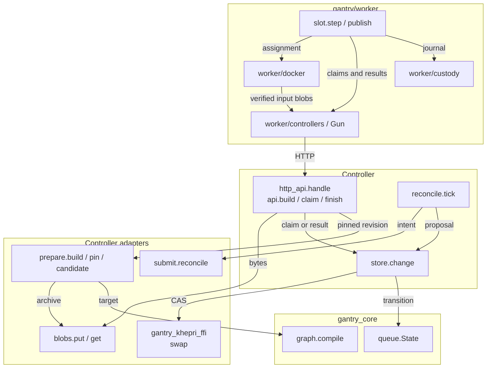
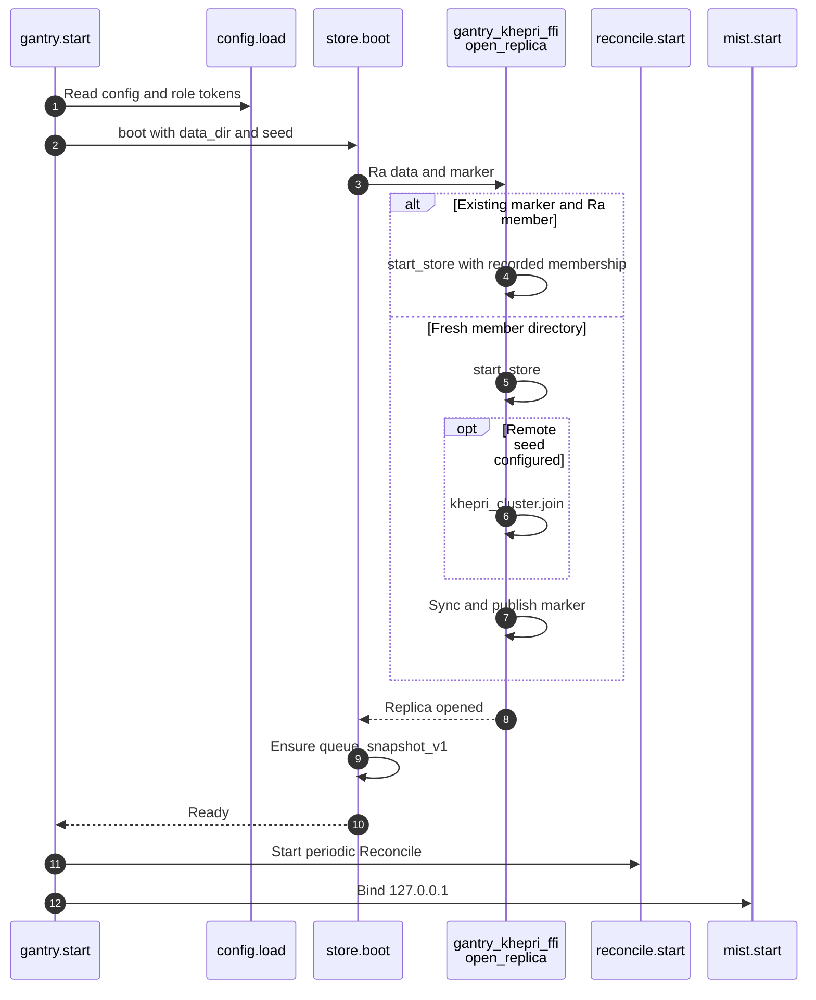
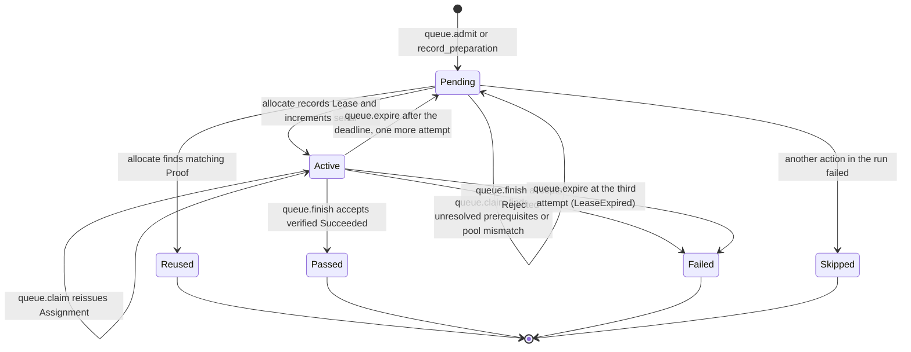
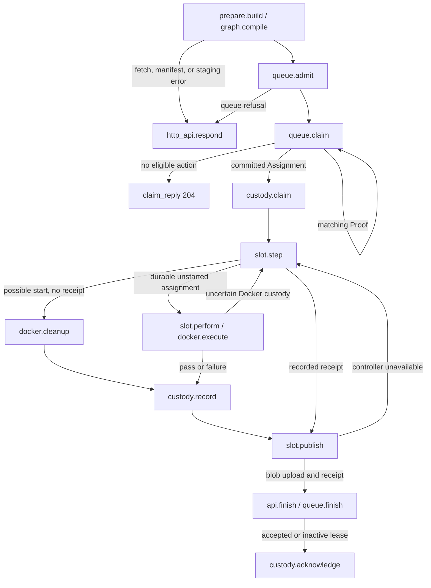
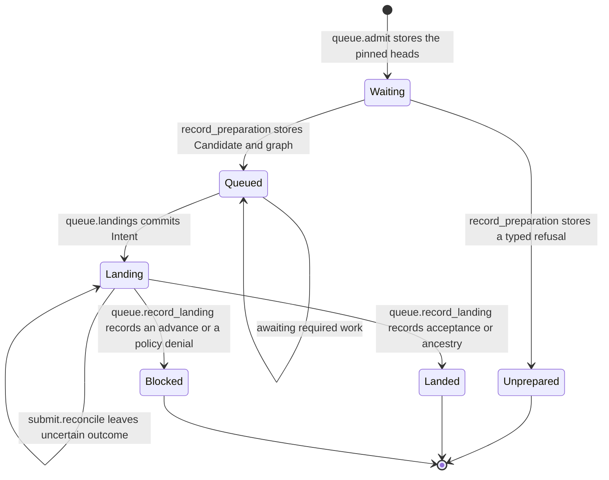
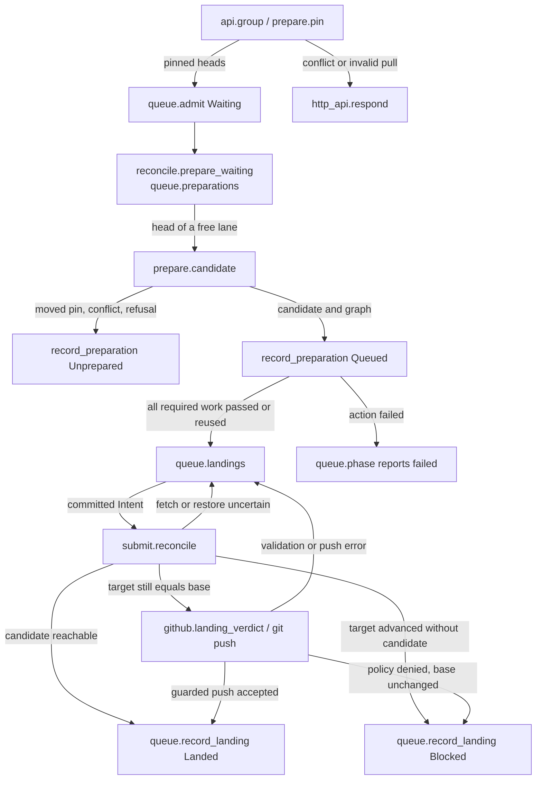
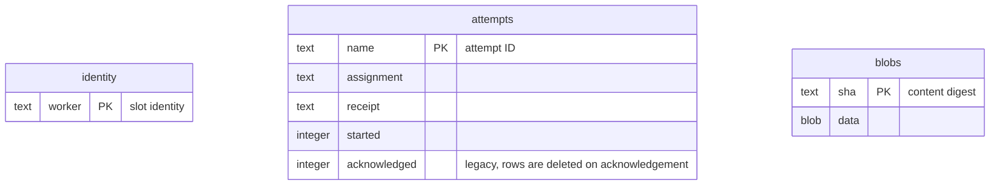

# Gantry runtime architecture

Gantry turns a pinned Git revision into an action graph, stores the
current run and leases in Khepri, and runs leased actions on Docker
workers. The same graph can supply evidence for a guarded Git push.
The source links point to the implementation in this checkout, including
the Gleam worker and the controller and worker OTP entry points.
[Status](#status) · [Tour](../guide/tour.md) · [Runbook](../running.md) ·
[HTTP API](../api.md) · [How work is spread](../scheduling.md) ·
[Operations](../operations.md) · [Target design](build-and-submit.md)

## Components

Each controller serves HTTP and runs a submit reconciler. Both use the
same quorum queue store. The worker keeps its own record of
whether Docker may have started an assignment.

The queue controls whether an action is eligible to run and whether its
result can affect the graph. The worker can replay its result without
asking a controller to execute the action again. Git evaluates the
target's expected old object ID at the point of the ref update.

Configuration reads use Envoy. The worker loads its journal schema through
the typed OTP application and filesystem bindings. Custom Erlang bridges
handle Khepri/Ra, process ports, durable filesystem sync, tar, and bounded
Gun streams. The Gleam adapters expose HTTP methods and queue outcomes as
domain types, and construct the Docker environment from its allowlist.

| Component | Responsibilities | Effect or state owner it calls |
| --- | --- | --- |
| `http_api.handle`, `api` | Role checks, request decoding, admission and receipt responses | `prepare`, `store.change`, and `blobs` |
| `graph`, `queue` | Pure graph closure, cache keys, lease decisions, and submission transitions | Controllers supply data and persist the resulting `State` |
| `store`, `gantry_khepri_ffi` | Quorum reads and atomic queue replacement | Khepri and its Ra system |
| `gantry/worker`, `worker/custody` | Slot lifecycle, journaled assignment and receipt, and publication replay | SQLite journal in the worker directory |
| `worker/docker` | Input staging, Docker execution, output collection, and cleanup | Docker CLI through an Erlang port |
| `worker/controllers` | Bounded HTTP requests, controller failover, and input digest checks | Gun through the HTTP FFI |
| `prepare`, `git`, `submit` | Git input projection, candidate construction, and exact-ref reconciliation | Shared candidate bundle and remote Git ref |

## Start a controller and replica

`gantry.start` boots the queue before starting the reconciler and
binding the HTTP listener.

The marker ties an established member to its Erlang node name. A changed
name or missing durable member record causes startup to fail. This
check prevents an established controller from serving an empty
singleton queue after losing its Ra record.
[Controller entry point](../../packages/server/src/gantry.gleam) ·
[Replica startup](../../packages/server/src/gantry_khepri_ffi.erl)

## Run an action graph

`api.build` prepares a graph and its source archives from the requested
commit. `Plan` returns the action closure. `Run` admits an ordered set
of `Work` records. The pure core decides an action's phase using its
prerequisites and the current queue snapshot.

A lease's deadline is the claim time plus the action's `timeout` plus 150
seconds, and nothing renews it. Every `queue.claim` runs `queue.expire`
first. An action whose deadline has passed returns to `Pending` with one more
attempt, and its next lease takes a fresh serial, so a late result for the
old serial gets HTTP 409 and the worker discards it. The third lapse fails
the action as `LeaseExpired`, and a failure turns the run's other `Pending`
actions into `Skipped`. A result that arrives after the deadline but before
any claim has expired the lease is still accepted. A worker restart resumes
the same assignment or reports an interrupted action after cleanup.

1. **Prepare.** `prepare.build` fetches the immutable revision. For a
   declared target, `graph.compile` validates the manifest, orders its
   actions, and selects the target's dependency closure. For an ad hoc
   action, `graph.validate_action` checks the action and preparation
   uses the run ID in its cache scope.
2. **Claim.** The worker posts to `/v1/claims`. `queue.claim` expires lapsed
   leases, returns an existing active assignment for that worker, or looks
   for ready work in enrollment order ([how work is spread](../scheduling.md)). A compatible action requires passing results
   for both edge types. Only `deps` supplies files to the cache key.
   A cache hit reuses the stored proof. A miss creates a lease in the
   same `store.change` that advances the queue serial.
3. **Execute.** `slot.claim` records the assignment in SQLite.
   `docker.execute` removes any resources left under the attempt's name,
   stages input blobs after `controllers.fetch` verifies their digests,
   and creates the volume, collector and action container. It calls
   `custody.mark_started` immediately before `docker start`, the one
   effect that runs action code. The action receives read-only archives
   and a private temporary workspace. Its container has no network, drops all
   capabilities, runs as an unprivileged user on a read-only root, and takes
   its CPU, memory, process, open-file, workspace, and `/tmp` limits from the
   slot's `GANTRY_WORKER_*` settings ([runbook](../running.md#start-a-worker)). `docker start -a` runs as a Weft
   task with a deadline, whose cancel capability removes the containers.
   After the action container exits, the collector reads the declared
   outputs.
4. **Publish.** `slot.step` journals the finished result first, then
   removes the Docker resources from the Recorded phase. `slot.publish`
   uploads the bytes the receipt references, and no others, before
   posting the receipt. `api.finish` reads and rehashes the referenced
   blobs.
   `queue.finish` accepts the receipt only for the active action,
   worker, and serial. A passing receipt must also match the declared
   output paths.
5. **Resume.** `controllers.call` tries the next configured origin
   after a transport error or a 5xx response. Gun verifies the peer
   certificate and host name for HTTPS and keeps one connection per
   origin, replacing it once if it proves dead before a response byte.
   Each exchange has a connect timeout, a response wait that grows with
   the declared upload size, and an idle bound that restarts at every
   response chunk. On restart, the worker publishes a saved receipt or
   resumes staging an unstarted assignment. If the journal records a
   possible start with no receipt, the worker removes any remaining
   Docker resources before reporting failure.

Which infrastructure faults reach users as a failed action:

| Fault | Outcome | Why |
| --- | --- | --- |
| Controller offline, blob fetch or upload fails, or HTTP 5xx | Retried with backoff, the receipt stays journaled | Nothing about the action is lost |
| Collector image missing at boot | The worker exits with the `docker pull` command | The first action would fail otherwise |
| Docker fault while staging or creating resources, before `docker start` | Retried, the same attempt runs again | No action code has run, and `execute` removes leftovers first |
| Docker fault while removing resources after the action finished | Retried, the recorded result is kept | The result is journaled before cleanup |
| Worker restart or Docker fault after `docker start` and before the result is recorded | `Rejected: worker interrupted before recording outcome` | The action may have run, so running it again could repeat its effects, and the wire protocol has no worker-reported requeue |
| Action exit status, wall deadline, or a missing or oversized declared output | `Rejected` with the reason and the log | The action itself failed |
| Unsafe path or invalid archive in the inputs | `Rejected` | The same input would fail again |
| Worker lost, or slower than the lease deadline | The action is leased again, up to three attempts, then `expired` | No renewal exists, and a late result is refused with 409 |
| Unreadable journal, mismatched assignment, or a controller response the worker cannot trust | The worker halts and the lease stays | Local custody cannot be trusted, so an operator restores it |

The action key combines the prepared recipe digest with the resolved
dependency file digests. The recipe includes the selected source archive
and worker image. A producer can run again and return identical files.
Its dependent action then retains the same key and can reuse its proof.
[Graph and queue](../../packages/core/src/gantry_core/queue.gleam) ·
[Worker loop](../../packages/server/src/gantry/worker.gleam) ·
[Worker custody](../../packages/server/src/gantry/worker/custody.gleam) ·
[Docker adapter](../../packages/server/src/gantry/worker/docker.gleam) ·
[Controller client](../../packages/server/src/gantry/worker/controllers.gleam) ·
[Gun FFI](../../packages/server/src/gantry_worker_http_ffi.erl)

## Land an ordered PR group

A lane is a registered repository and target branch. A submission is
admitted as `Waiting` with its pinned PR heads and no graph. When it heads
a free lane, the reconciler builds a `Candidate`, which records the expected
old branch SHA, the integration commit, and the ordered PR heads included in
that commit. `Intent` ties that candidate to the run that supplied its build
proof.

A `Waiting` group never builds, and a `Queued` run that has not failed, or a
`Landing` run, holds its lane. A failed action in a queued group yields run
phase `failed` and releases the lane. The submission tag stays `Queued`.
Ordinary builds enter with the `Build` submission tag and finish through the
action graph.

1. **Pin.** `api.group` calls `prepare.pin`, which fetches each
   `refs/pull/N/head` through the repository's mirror and, for GitHub, reads
   the pull and checks that it targets the configured branch. It admits the
   group as `Waiting` with those heads. Nothing is built yet, so a group
   queued behind another never builds on a base that is about to move.
2. **Prepare.** Every second the reconciler asks `queue.preparations` for
   the waiting run at the head of each free lane. `prepare.candidate` fetches
   the branch tip, re-reads every pinned pull (a moved head ends the wait as
   `member_moved`), and merges the heads in order with Git's `merge-tree` and
   `commit-tree`, one integration commit per member. A conflict ends the wait
   as `unmergeable`. Otherwise it reads `gantry.json` from the tip, stages
   the selected files from the candidate, and `git.preserve` publishes the
   candidate bundle to shared storage. `queue.record_preparation` then moves
   exactly that run to `Queued` with its graph, or to `Unprepared` with the
   typed reason. A Git or GitHub failure records nothing, and the group is
   retried with backoff.
3. **Prove.** The action graph must pass. `queue.landings` reserves
   eligible lanes and constructs their intents in a committed queue
   update. An earlier unfinished group occupies its lane.
4. **Apply or recover.** `submit.reconcile` fetches the target and
   restores the candidate bundle. It checks candidate identity and
   ancestry. If the candidate is already reachable, the controller
   records `Landed`. If the target advanced elsewhere, it records
   `Blocked` as `target_advanced`. Otherwise it revalidates the pinned
   members and uses `--force-with-lease` with the expected old SHA to push
   the candidate. A policy denial while the target still equals the base is
   checked once more and then recorded as `Blocked` with `policy_denied`.
   Any other uncertain result leaves the same intent available for replay.
5. **Report.** `queue.record_landing` matches the observation to the
   outstanding intent before storing the result. The optional GitHub
   workflow polls until `landed` and then publishes the commit link
   on the original PRs.

Git checks the condition on the target ref. The provider read that checks
the source heads happens before the push. The commit still identifies
the exact heads that passed if a PR changes during that interval.
[Submit implementation](../../packages/server/src/gantry/submit.gleam) ·
[GitHub workflow](../examples/github-submit.yml)

## Storage

Khepri stores one `State`. The shared filesystem holds the large
objects referenced by that state. Each worker keeps a private SQLite
journal for its active assignment and unpublished result.

| Store | Owner and key | Data |
| --- | --- | --- |
| Khepri | `gantry_khepri_ffi`, path `queue_snapshot_v1` | Encoded `State` with runs, action phases, proofs, and submission intents |
| Shared filesystem | `blobs.put`, `objects/<digest>` | Source archives, output bytes, and logs addressed by SHA-256 |
| Shared filesystem | `git.preserve`, `git/<repo>/<commit>.bundle` | Candidate objects required beyond the pinned base |
| Worker SQLite | `worker/custody`, `custody.sqlite3` in the worker directory | Slot identity, assignments, receipts, and upload spool |

`gantry/worker` holds one SQLite connection for execution and publication.
The following tables are local to that worker.

The journal uses SQLite `synchronous=FULL`. `custody.record` stores
the receipt after execution or cleanup. After the server returns success
or reports an inactive lease, `custody.acknowledge` deletes the
attempt row and clears the upload spool in one transaction. Both the queue
and the journaled receipt refer to uploaded bytes by digest.
[Worker journal schema](../../packages/server/priv/worker-schema.sql)

`store.change` computes a pure proposal from a fenced local snapshot.
A mutation compares and swaps the exact snapshot bytes through Khepri.
An unchanged proposal asks a Ra leader query, after the leader confirms
its authority with a majority, whether its copy hashes to the SHA-256 of
the expected bytes. Only that answer returns to the caller. A conflict causes
the store to rebuild the proposal, with up to eight total attempts.
When every action in a snapshot is terminal, a controller can remember
its digest locally. A worker poll first checks that digest through the
same leader query. A match proves there is no lease to issue or
replay. A miss runs the normal claim decision.
The controller allows up to 64 MiB per blob. It syncs object bytes
before atomic rename and syncs the containing directory before
returning a digest. Cache reuse takes the proof from a recorded
`Passed` action in the same repository. Preserve objects referenced by
live runs and cached proofs.
[Queue store](../../packages/server/src/gantry/store.gleam) ·
[Object store](../../packages/server/src/gantry/blobs.gleam)

### Bounds on retained state

The queue snapshot has a 4 MiB ceiling, and a mutation that would pass it is
refused with HTTP 500. Two bounds keep it far below that. Text from outside
(a worker's rejection reason, a provider's denial) is capped at 1024 bytes
where the queue records it. The reconciler on every controller then trims the
snapshot once a minute (`queue.retain`): it drops the oldest terminal runs
beyond `[retention] keep_runs` and the oldest remembered proofs beyond
`keep_proofs` in `controller.toml`. The defaults are 200 and 1000, and the
accepted ranges are 1 to 5000 and 1 to 20000. A run that is not terminal, that
holds a lane, or that waits for one is never dropped. A dropped run loses its
status, and reuse continues from the proof index until its proofs are
dropped too.

Blobs and candidate bundles on the shared filesystem are not collected. They
grow with every run until an operator prunes them.

## Concurrency

Each mutable item has one authority even when several controllers
propose changes concurrently.

| Process or service | Owns |
| --- | --- |
| Mist request handler | The request, its validation, and a proposal submitted to `store.change` |
| Khepri and Ra | The committed queue snapshot and ordering of accepted replacements |
| Static supervisor | The Mist listener and the reconciler. It restarts whichever crashes, and past five restarts in a minute it exits so the VM stops |
| Weft reconciler per controller | Its periodic `Reconcile` message, its per-intent backoff table, and sequential provider calls for the intents it received |
| Git mirror lock | One repository's persistent bare mirror, held by one request or reconciler attempt at a time |
| `gantry/worker` slot loop | One slot and its journal connection, run as a Weft actor under a supervisor. A crash restarts it with the same journal |
| Journal lock | SQLite's exclusive lock on the slot's connection, held while the connection lives and released by the OS at exit |
| `docker start -a` task | A Weft task with a deadline. Its cancel capability removes the containers on timeout or when the slot loop dies |
| Erlang host and worker FFI | The shared port runner for Docker and host tools, which kills the child by pid at its deadline, and tar operations |
| Gun connection | One reused connection per controller origin, owned by the slot loop, with connect, first-byte and idle bounds |
| Docker daemon | Container execution and temporary volumes |
| Remote Git server | The target ref and the expected-old-SHA check at update time |

The reconciler waits one second between periodic ticks and retries an
unresolved intent after 1 s, then 2 s, doubling up to 60 s. It logs every
error. A definite policy refusal, observed before this controller pushed,
blocks the run with its reason, and an indeterminate outcome stays open.
Each repository has one persistent bare mirror under `data_dir/mirrors`,
fetched incrementally under a node-local lock. Controllers may
try the same committed intent concurrently. The queue matches results
to that intent, and Git rejects a push if the target moved. A storage
timeout can leave the commit outcome unknown. Use the same run or
attempt identity when retrying. The journal lock covers one
machine's local journal. Operators assign each worker ID to a single
slot across the deployment.
[Reconciler](../../packages/server/src/gantry/reconcile.gleam) ·
[Host runner FFI](../../packages/server/src/gantry_host_ffi.erl)

## Status

This section is the one place that says how far the system has gotten. The
README, the runbook, and the other design pages link here instead of
repeating it. [Handoff and next steps](../next.md)

**Built and exercised by `make e2e`:** pinned Git inputs, declared and ad
hoc actions, Docker workers with per-worker credentials, three-voter queue
recovery, lease expiry and reassignment, deferred preparation of waiting
groups, retention, and a guarded landing against a local bare remote.
**Verified live on GitHub:** exact landing, PR reconciliation, and idempotent
workflow comments on a disposable, unprotected target branch
([pilot](../integrating.md#check-a-live-deployment)).

**Open:**

- A deployment with protected-branch rules needs its own pilot, using the
  controller identity it will run with. This is the only GitHub item left.
- The queue is one snapshot with a whole-document swap. The benchmark has met
  the reconsideration trigger of [ADR 001](../adr/001-khepri-owns-queue-decisions.md#addendum--2026-11-24--the-benchmark-meets-the-reconsideration-trigger)
  (on the four-vCPU benchmark host, throughput saturates near 20 actions per second with 100 repositories),
  and the indexed layout is not built.
- Loom's executor is not used. [ADR 003](../adr/003-gantry-docker-worker.md)
  records why, and what an interop proof would need to show.
- No cancel route, workspace overlay, event cursor, resource reservation,
  quota, or priority exists. The [design pages](build-and-submit.md#what-is-built)
  describe some of them as targets.
- A landing that cannot be resolved holds its lane until the target branch
  moves. [Recovery](../operations.md#a-landing-is-stuck)
- Blobs and candidate bundles are never collected, and restoring a voter
  from backup has no tested procedure.
- Fleet commands beyond `init --local` and `worker setup` are unbuilt
  ([fleet bootstrap](../design-notes/fleet-bootstrap.md#whats-built-and-whats-not)).
