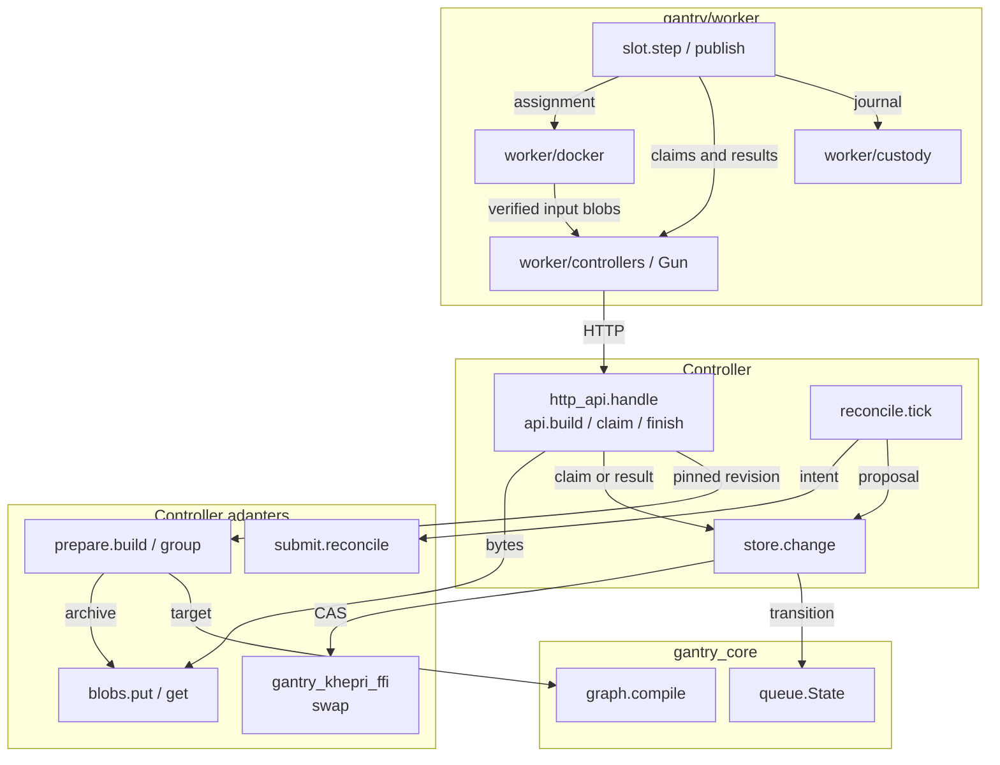
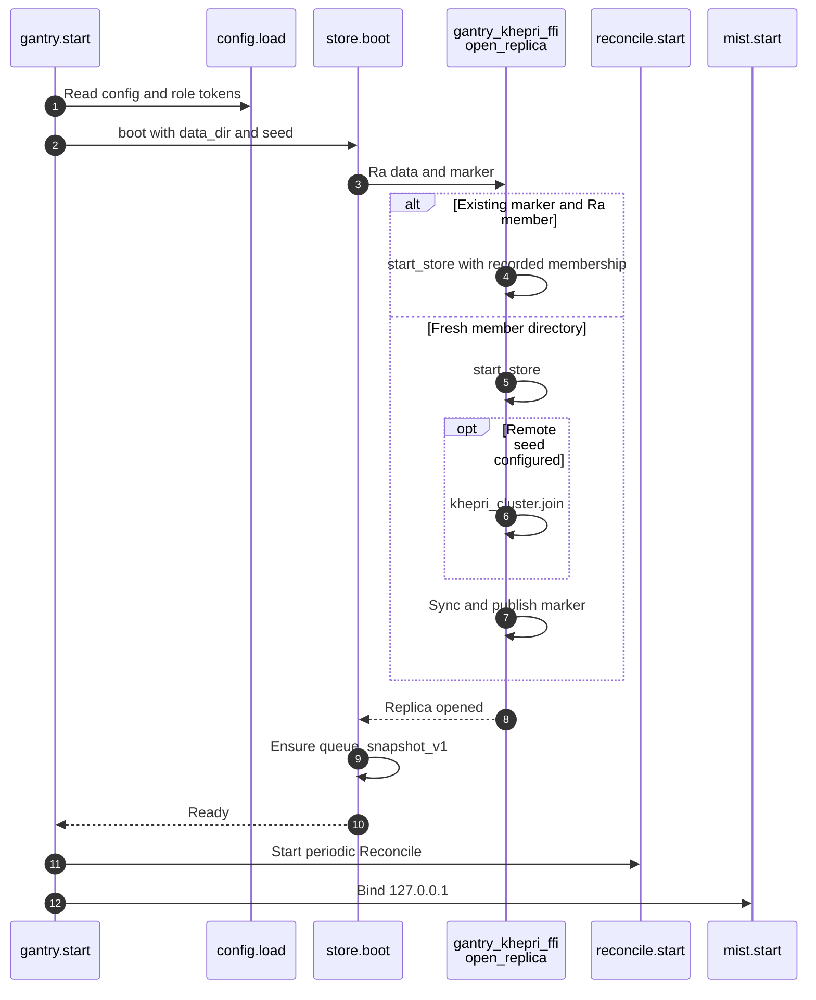
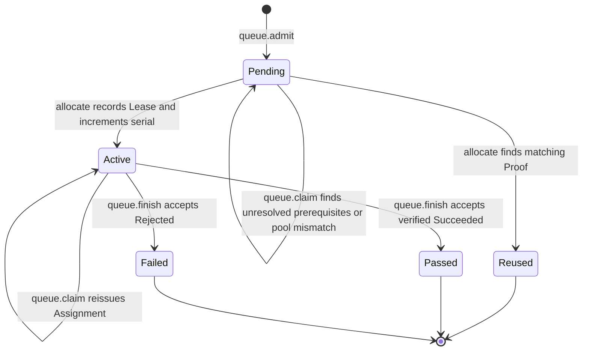
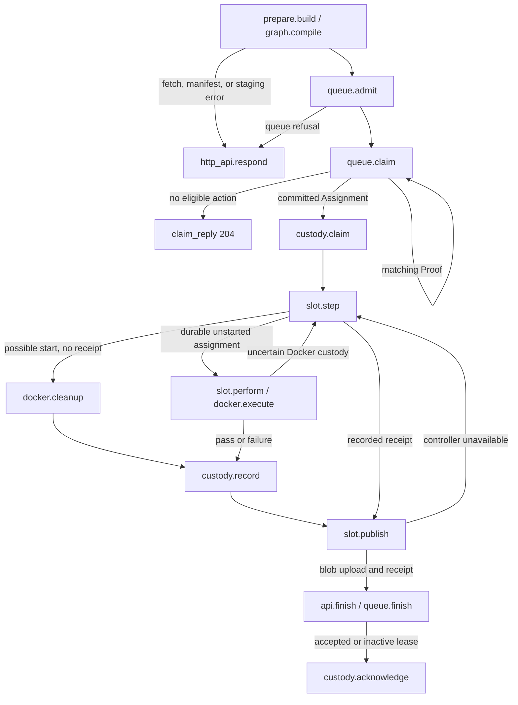
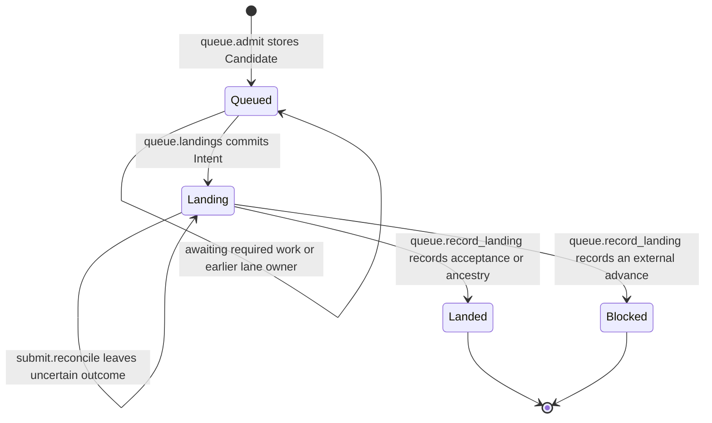
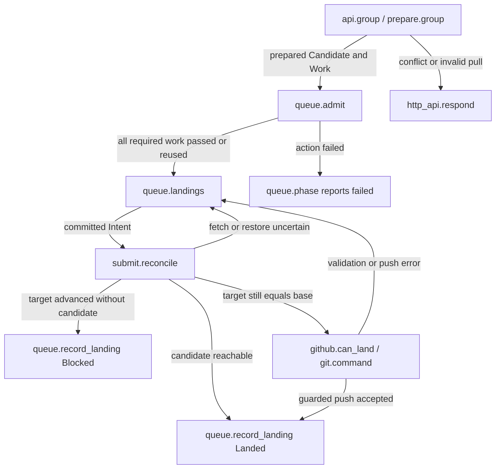
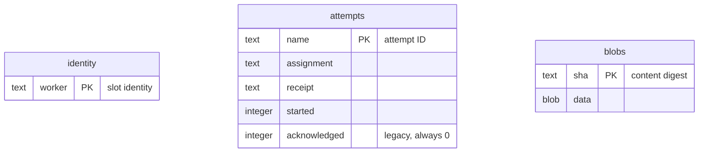

# Gantry runtime architecture

Gantry turns a pinned Git revision into an action graph, stores the
current run and leases in Khepri, and runs leased actions on Docker
workers. The same graph can supply evidence for a guarded Git push.
The source links point to the implementation in this checkout, including
the Gleam worker and the controller and worker OTP entry points.
[Runbook](../running.md) · [Build and submit design](build-and-submit.md)

## Components

Each controller serves HTTP and runs a submit reconciler. Both use the
same quorum queue store. The worker keeps its own record of
whether Docker may have started an assignment.

The queue controls whether an action is eligible to run and whether its
result can affect the graph. The worker can replay its result without
asking a controller to execute the action again. Git evaluates the
target's expected old object ID at the point of the ref update.

Configuration reads use Envoy. The worker loads its journal schema through
the typed OTP application and filesystem bindings. Custom Erlang bridges
handle Khepri/Ra, process ports, durable filesystem sync, tar, and bounded
Gun streams. The Gleam adapters expose HTTP methods and queue outcomes as
domain types, and construct the Docker environment from its allowlist.

| Component | Responsibilities | Effect or state owner it calls |
| --- | --- | --- |
| `http_api.handle`, `api` | Role checks, request decoding, admission and receipt responses | `prepare`, `store.change`, and `blobs` |
| `graph`, `queue` | Pure graph closure, cache keys, lease decisions, and submission transitions | Controllers supply data and persist the resulting `State` |
| `store`, `gantry_khepri_ffi` | Quorum reads and atomic queue replacement | Khepri and its Ra system |
| `gantry/worker`, `worker/custody` | Slot lifecycle, journaled assignment and receipt, and publication replay | SQLite journal in the worker directory |
| `worker/docker` | Input staging, Docker execution, output collection, and cleanup | Docker CLI through an Erlang port |
| `worker/controllers` | Bounded HTTP requests, controller failover, and input digest checks | Gun through the HTTP FFI |
| `prepare`, `git`, `submit` | Git input projection, candidate construction, and exact-ref reconciliation | Shared candidate bundle and remote Git ref |

## Start a controller and replica

`gantry.start` boots the queue before starting the reconciler and
binding the HTTP listener.

The marker ties an established member to its Erlang node name. A changed
name or missing durable member record causes startup to fail. This
check prevents an established controller from serving an empty
singleton queue after losing its Ra record.
[Controller entry point](../../packages/server/src/gantry.gleam) ·
[Replica startup](../../packages/server/src/gantry_khepri_ffi.erl)

## Run an action graph

`api.build` prepares a graph and its source archives from the requested
commit. `Plan` returns the action closure. `Run` admits an ordered set
of `Work` records. The pure core decides an action's phase using its
prerequisites and the current queue snapshot.

`Lease.until` records a deadline hint. The queue keeps the active
lease until it accepts a matching result. A worker restart resumes
the same assignment or reports an interrupted action after cleanup.

1. **Prepare.** `prepare.build` fetches the immutable revision. For a
   declared target, `graph.compile` validates the manifest, orders its
   actions, and selects the target's dependency closure. For an ad hoc
   action, `graph.validate_action` checks the action and preparation
   uses the run ID in its cache scope.
2. **Claim.** The worker posts to `/v1/claims`. `queue.claim` returns an
   existing active assignment for that worker or looks for ready work
   in enrollment order. A compatible action requires passing results
   for both edge types. Only `deps` supplies files to the cache key.
   A cache hit reuses the stored proof. A miss creates a lease in the
   same `store.change` that advances the queue serial.
3. **Execute.** `slot.claim` records the assignment in SQLite.
   `docker.execute` removes any resources left under the attempt's name,
   stages input blobs after `controllers.fetch` verifies their digests,
   and creates the volume, collector and action container. It calls
   `custody.mark_started` immediately before `docker start`, the one
   effect that runs action code. The action receives read-only archives
   and a private temporary workspace. `docker start -a` runs as a Weft
   task with a deadline, whose cancel capability removes the containers.
   After the action container exits, the collector reads the declared
   outputs.
4. **Publish.** `slot.step` journals the finished result first, then
   removes the Docker resources from the Recorded phase. `slot.publish`
   uploads the bytes the receipt references, and no others, before
   posting the receipt. `api.finish` reads and rehashes the referenced
   blobs.
   `queue.finish` accepts the receipt only for the active action,
   worker, and serial. A passing receipt must also match the declared
   output paths.
5. **Resume.** `controllers.call` tries the next configured origin
   after a transport error or a 5xx response. Gun verifies the peer
   certificate and host name for HTTPS and keeps one connection per
   origin, replacing it once if it proves dead before a response byte.
   Each exchange has a connect timeout, a response wait that grows with
   the declared upload size, and an idle bound that restarts at every
   response chunk. On restart, the worker publishes a saved receipt or
   resumes staging an unstarted assignment. If the journal records a
   possible start with no receipt, the worker removes any remaining
   Docker resources before reporting failure.

Which infrastructure faults reach users as a failed action:

| Fault | Outcome | Why |
| --- | --- | --- |
| Controller offline, blob fetch or upload fails, or HTTP 5xx | Retried with backoff, the receipt stays journaled | Nothing about the action is lost |
| Collector image missing at boot | The worker exits with the `docker pull` command | The first action would fail otherwise |
| Docker fault while staging or creating resources, before `docker start` | Retried, the same attempt runs again | No action code has run, and `execute` removes leftovers first |
| Docker fault while removing resources after the action finished | Retried, the recorded result is kept | The result is journaled before cleanup |
| Worker restart or Docker fault after `docker start` and before the result is recorded | `Rejected: worker interrupted before recording outcome` | The action may have run, so running it again could repeat its effects, and the wire protocol has no worker-reported requeue |
| Action exit status, wall deadline, or a missing or oversized declared output | `Rejected` with the reason and the log | The action itself failed |
| Unsafe path or invalid archive in the inputs | `Rejected` | The same input would fail again |
| Unreadable journal, mismatched assignment, or a controller response the worker cannot trust | The worker halts and the lease stays | Local custody cannot be trusted, so an operator restores it |

The action key combines the prepared recipe digest with the resolved
dependency file digests. The recipe includes the selected source archive
and worker image. A producer can run again and return identical files.
Its dependent action then retains the same key and can reuse its proof.
[Graph and queue](../../packages/core/src/gantry_core/queue.gleam) ·
[Worker loop](../../packages/server/src/gantry/worker.gleam) ·
[Worker custody](../../packages/server/src/gantry/worker/custody.gleam) ·
[Docker adapter](../../packages/server/src/gantry/worker/docker.gleam) ·
[Controller client](../../packages/server/src/gantry/worker/controllers.gleam) ·
[Gun FFI](../../packages/server/src/gantry_worker_http_ffi.erl)

## Land an ordered PR group

A lane is a registered repository and target branch. A `Candidate`
records the expected old branch SHA, the integration commit, and the
ordered PR heads included in that commit. `Intent` ties that candidate
to the run that supplied its build proof.

A failed action in a queued group yields run phase `failed` and
releases the lane. The submission tag stays `Queued`. Ordinary builds
enter with the `Build` submission tag and finish through the action
graph.

1. **Pin.** `prepare.group` fetches the target, resolves the ordered
   PR heads with `prepare.member`, and builds a deterministic candidate
   with Git's `merge-tree` and `commit-tree`. Group preparation shares
   one temporary bare repository created by `git.session`.
2. **Prepare.** `prepare.tasks` reads `gantry.json` from the pinned base
   and stages the selected files from the candidate. `git.preserve`
   publishes the candidate bundle to shared storage before admission.
3. **Prove.** The action graph must pass. `queue.landings` reserves
   eligible lanes and constructs their intents in a committed queue
   update. An earlier unfinished group occupies its lane.
4. **Apply or recover.** `submit.reconcile` fetches the target and
   restores the candidate bundle. It checks candidate identity and
   ancestry. If the candidate is already reachable, the controller
   records `Landed`. If the target advanced elsewhere, it records
   `Blocked`. Otherwise it revalidates the pinned members and uses
   `--force-with-lease` with the expected old SHA to push the candidate.
   An uncertain result leaves the same intent available for replay.
5. **Report.** `queue.record_landing` matches the observation to the
   outstanding intent before storing the result. The optional GitHub
   workflow polls until `landed` and then publishes the commit link
   on the original PRs.

Git checks the condition on the target ref. The provider read that checks
the source heads happens before the push. The commit still identifies
the exact heads that passed if a PR changes during that interval.
[Submit implementation](../../packages/server/src/gantry/submit.gleam) ·
[GitHub workflow](../examples/github-submit.yml)

## Storage

Khepri stores one `State`. The shared filesystem holds the large
objects referenced by that state. Each worker keeps a private SQLite
journal for its active assignment and unpublished result.

| Store | Owner and key | Data |
| --- | --- | --- |
| Khepri | `gantry_khepri_ffi`, path `queue_snapshot_v1` | Encoded `State` with runs, action phases, proofs, and submission intents |
| Shared filesystem | `blobs.put`, `objects/<digest>` | Source archives, output bytes, and logs addressed by SHA-256 |
| Shared filesystem | `git.preserve`, `git/<repo>/<commit>.bundle` | Candidate objects required beyond the pinned base |
| Worker SQLite | `worker/custody`, `custody.sqlite3` in the worker directory | Slot identity, assignments, receipts, and upload spool |

`gantry/worker` holds one SQLite connection for execution and publication.
The following tables are local to that worker.

The journal uses SQLite `synchronous=FULL`. `custody.record` stores
the receipt after execution or cleanup. After the server returns success
or reports an inactive lease, `custody.acknowledge` deletes the
attempt row and clears the upload spool in one transaction. Both the queue
and the journaled receipt refer to uploaded bytes by digest.
[Worker journal schema](../../packages/server/priv/worker-schema.sql)

`store.change` computes a pure proposal from a fenced local snapshot.
A mutation compares and swaps the exact snapshot bytes through Khepri.
An unchanged proposal checks the same bytes through a Ra leader query
that confirms the leader's authority with a majority. A conflict causes
the store to rebuild the proposal, with up to eight total attempts.
The queue snapshot has a 4 MiB ceiling.
When every action in a snapshot is terminal, a controller can remember
its exact bytes locally. A worker poll first checks those bytes through
the same quorum read. A match proves there is no lease to issue or
replay. A miss runs the normal claim decision.
The controller allows up to 64 MiB per blob. It syncs object bytes
before atomic rename and syncs the containing directory before
returning a digest. Cache reuse takes the proof from a recorded
`Passed` action in the same repository. Preserve objects referenced by
live runs and cached proofs.
[Queue store](../../packages/server/src/gantry/store.gleam) ·
[Object store](../../packages/server/src/gantry/blobs.gleam)

## Concurrency

Each mutable item has one authority even when several controllers
propose changes concurrently.

| Process or service | Owns |
| --- | --- |
| Mist request handler | The request, its validation, and a proposal submitted to `store.change` |
| Khepri and Ra | The committed queue snapshot and ordering of accepted replacements |
| Weft reconciler per controller | Its periodic `Reconcile` message and sequential provider calls for the intents it received |
| `gantry/worker` slot loop | One slot and its journal connection, run as a Weft actor under a supervisor. A crash restarts it with the same journal |
| Journal lock | SQLite's exclusive lock on the slot's connection, held while the connection lives and released by the OS at exit |
| `docker start -a` task | A Weft task with a deadline. Its cancel capability removes the containers on timeout or when the slot loop dies |
| Erlang host and worker FFI | The shared port runner for Docker and host tools, which kills the child by pid at its deadline, and tar operations |
| Gun connection | One reused connection per controller origin, owned by the slot loop, with connect, first-byte and idle bounds |
| Docker daemon | Container execution and temporary volumes |
| Remote Git server | The target ref and the expected-old-SHA check at update time |

The reconciler waits one second between periodic ticks. Controllers may
try the same committed intent concurrently. The queue matches results
to that intent, and Git rejects a push if the target moved. A storage
timeout can leave the commit outcome unknown. Use the same run or
attempt identity when retrying. The journal lock covers one
machine's local journal. Operators assign each worker ID to a single
slot across the deployment.
[Reconciler](../../packages/server/src/gantry/reconcile.gleam) ·
[Host runner FFI](../../packages/server/src/gantry_host_ffi.erl)

## Known gaps

- The end-to-end fixture covers a local bare Git remote. Live GitHub
  branch rules, PR updates, and workflow comments need a repo pilot.
- A permanently lost worker can leave an active lease. Recovery uses
  the original worker directory and journal. Safe reassignment needs
  a way to prove physical custody has ended.
- Agents poll the current snapshot. The store caps retained metadata
  and scans recorded proofs for reuse. Throughput under a large
  multi-repository workload still needs measurement.
