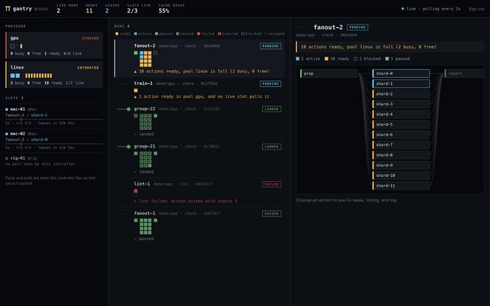
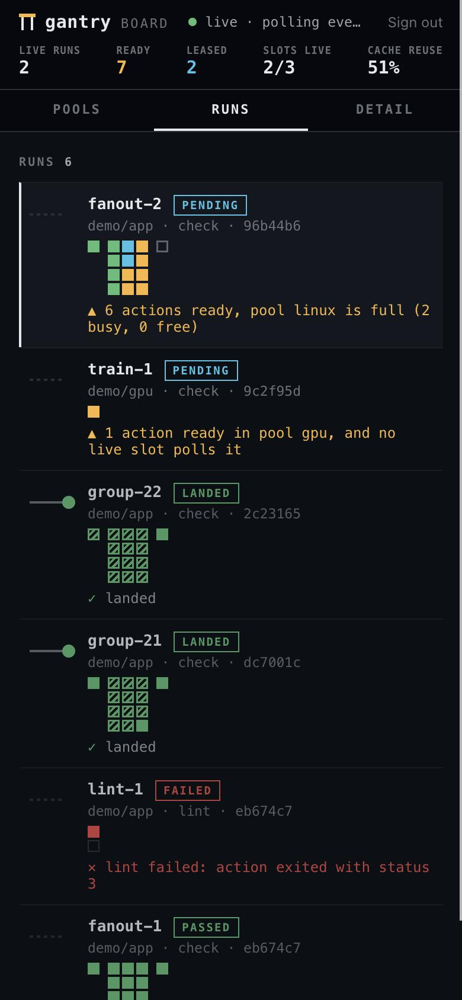
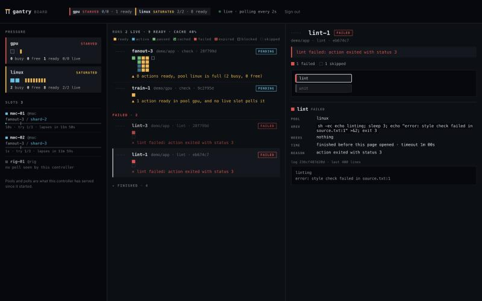
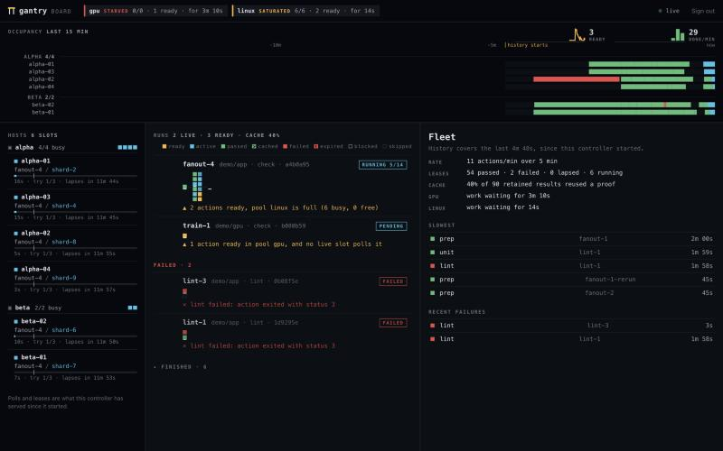
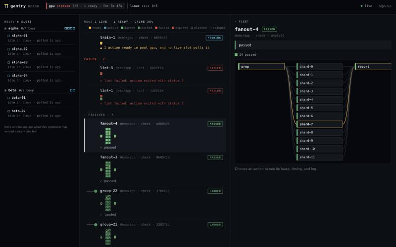
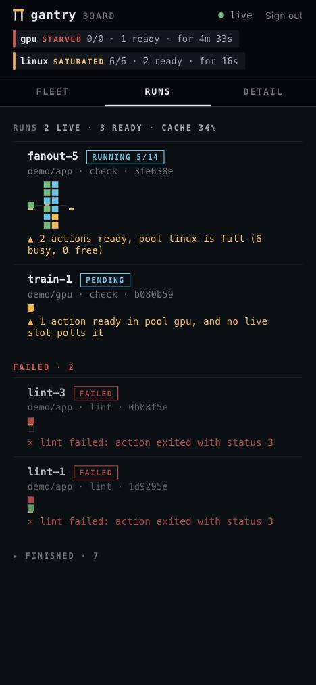
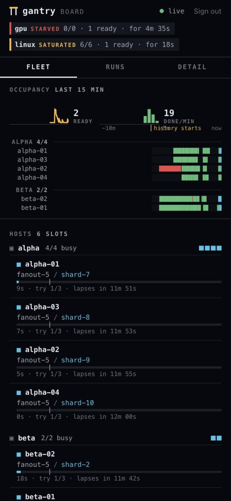

# Dashboard: the pressure board

**Status:** built on branch `dashboard`, not merged. Three design councils
ruled on it, and the rulings, the dissent, and the screenshots are below.
The current version is [v3](#v3-the-fleet-over-time).

## The question

Someone looking at the dashboard should be able to tell, at a glance, whether
the fleet is saturated and why a run is stuck. The dashboard shows live runs
with each action's state, which slot and host holds each lease, how busy
each pool is, the landing state of groups, and each action's log, timing,
and cache use. It is a Lustre application, built the way Loom builds its web
client.

## What the controller could already say, and what it could not

Before this work the API served one run by ID (`GET /v1/runs/{id}`) and
nothing else to read. A dashboard needed three more things:

| Need | Built | How |
| --- | --- | --- |
| Every run at once | `GET /v1/fleet` | Every retained run, encoded by `protocol.encode_run` |
| Which slots exist and what they serve | `slots` in the snapshot | The `[[worker]]` entries, each with the latest poll that this controller served, held in an ETS table (`gantry_presence_ffi.erl`) |
| A host for each slot | Optional `host` label on `[[worker]]` | A lease names only a worker ID, so a host label is the operator's to give |
| A read-only credential for a browser | Optional `GANTRY_VIEW_TOKEN` | Reads status, the snapshot, and blobs, and cannot admit work |
| A push stream | Not built | `EventSource` cannot send an `Authorization` header, so the page polls every 2 s, which is as often as an idle worker polls |

The snapshot's types live in `gantry_core/fleet`, which both the controller
and the dashboard compile, so the encoder and the decoder are one module.
The decoder is total and refuses a negative clock, a repeated slot or run, or
an unknown presence tag. The routes are in the [API reference](../api.md#the-fleet-snapshot).

What the snapshot still cannot say, and what the page shows instead:

- **Step times.** Steps carry no timestamps. A lease's grant time follows
  from its deadline, which the core sets once to the grant time plus the
  timeout plus `queue.lease_slack` and never renews (`fleet.granted`). v1 and
  v2 timed an action only if the page saw it leased. v3 reads the
  controller's lease history instead (see v3 below), and an action that
  finished before that history begins says so.
- **Leased versus running.** No message marks the start of an action after
  its lease, so both appear as `active`.
- **Presence in a quorum.** Presence is per controller and in memory, because
  writing every idle poll to the replicated queue would replicate the poll
  rate. In a three-voter quorum a slot that polls another voter reads as
  "no poll seen by this controller" on this one. Its leases still show,
  because leases are queue state.

## Directions considered

Three directions went to the first council, each described at the same
length:

1. **Switchyard.** Each repository lane is a rail track. A run is a train of
   action cars, and a coupling line joins each leased car to the siding of
   the slot that holds it.
2. **Slot timeline.** One swimlane per slot with lease bars on a live time
   axis, and a run table below.
3. **Pressure board.** A rail with one gauge per pool (ready actions against
   busy and free slots, with a verdict) and one row per slot. Next to it, the
   run list with each run's graph as a strip of state cells and one computed
   diagnosis line. A detail pane shows the chosen run's graph, action, lease,
   and log.

## First council: which direction

Three seats, each blind to the others and each assigned one lens (clarity
under load, operator workflow, visual distinctiveness), then a judge.

**Ruling: the pressure board, unanimous.** Saturation is a comparison of
demand with supply for each pool, and only this layout puts the two numbers
side by side with a verdict. Only this layout says on each run row why the
run is stuck. The diagnosis needs nothing the controller lacks except the
per-controller poll record.

Every seat verified a flaw in each alternative. The timeline's main canvas
needs step start and finish times the controller does not record, so a busy
fleet would look idle after a page load. The switchyard promised a host on
each coupling line when a lease names only a worker. It also drew `expired`
as a state of its own, but the core records an expiry as
`Failed(LeaseExpired(_))`, and with thirty trains the coupling lines would
cross.

**Dissent and conditions.** The workflow and distinctiveness seats ranked the
switchyard second. The distinctiveness seat warned that a three-pane layout
drifts toward an admin template if the run list becomes a plain table with
badges, so it asked that the cell strips and a track-and-signal lane glyph be
treated as required. The clarity seat warned that a wrong diagnosis misleads
more than a missing one, so each diagnosis names its evidence ("pool linux
is full (2 busy, 0 free)"), not a bare conclusion. The judge would revisit
the ruling if real runs turn out to be mostly short chains, or if the
controller starts recording step times, which would make a timeline worth a
second tab.

**Folded in from the other directions:** the switchyard's track and signal,
as each run's lane glyph (the signal's colour is the group's landing state);
the timeline's deadline tick, on each slot's lease bar.

## The first build

From a local controller with two slots in pool `linux`, a registered slot
`rig-01` that never polled, a `gpu` repository that no slot serves, a
12-shard fan-out, a failing `lint` target, and two groups in one lane:

`fanout-2` ten seconds apart at 1440 px, with no reload between them.
`shard-0` passed, `shard-2` took its slot, and ready work fell from 10 to 9:

A failed action with its lease facts and log tail:

At 390 px, the Runs and Pools tabs:

## Second council: what to refine

The seats read the screenshots above and weighed three options: ship the
first build as it is; add a **ribbon** of pool verdict chips to the header
and fold finished runs; or group the run list by repository **lane**.

**Ruling: the ribbon, amended (not unanimous).**

- **Chips replace the totals.** At 390 px the Runs tab showed only fleet
  totals, so nothing on screen said which pool was saturated. One chip per
  pool now takes the place of the totals row, drawn like the rail cards
  (verdict bar, name, verdict, busy over live, ready), and busy or idle pools
  are muted. The header does not grow. The live count and the cache rate
  moved to the Runs title.
- **Three bands.** The run list is live runs, then failed ones, then a folded
  "Finished" band. The ribbon as proposed folded failed runs too. The judge
  verified (`board.live` is false for `Broken`) that this would hide the
  failures an operator most needs, so only settled runs fold.
- **A failed run opens on its failure.** Choosing a broken run selects its
  first failed action and fetches the log, which saves a step on a phone.

**Dissent.** The clarity seat picked the ribbon as written, keeping the
totals and adding the chips as a row. The workflow and distinctiveness seats
wrote in the amended form. No seat ranked lanes first. The distinctiveness
seat ranked it above shipping for its railway look, but only if deployments
run many repositories and branches. The judge would fall back to chips as
their own row if operators turn out to rely on the fleet totals, or if
fleets run more than four or five pools, so the chips no longer fit at
390 px. The judge would consider lanes if head-of-line blocking within a
lane, not pool capacity, turns out to be the usual cause of a stall. If
failed runs pile up into the tens, the failed band should show only recent
ones.

## v3: the fleet over time

A review of the v2 screenshots raised five points. First, nothing answered
"saturated since when". Second, a run's cells read as an arbitrary grid,
and a run that had started still said "pending". Third, three things were
noise: the empty lane glyph on plain builds, pool verdicts drawn twice (in
the header chips and in the rail's cards), and slots that were not grouped
by host. Fourth, the empty detail pane should show fleet facts. Fifth, the
mobile header truncated. The first point depends on action start and
finish times that the queue does not record, so that question went to a
council. The other points are page changes that need no new data, and they
were made directly.

### Third council: where the times come from

The options were controller memory (a bounded event log for each
controller, served in `/v1/fleet`), durable step times in the queue image,
and history kept only in the client.

**Ruling: controller memory, unanimous.** Client history fails the first
criterion by construction: it starts empty on every page load, so it cannot
say since when. Durable times would put a clock into `queue.finish` and
change the step codec, the snapshot format, the churn oracle, and the model.
Those are the files the indexed-layout and worker-drain work is changing
now, and the times would only be displayed. Controller memory follows the
pattern presence already uses and leaves the queue untouched. Because the
live deployment has one controller, its history is complete there.

**Requirements the judge attached**, all built:

- `since` is served, and the page draws the time before it as unknown,
  never as idle. The axis marks where the history starts.
- A grant is recorded only after the store commits the claim, and is keyed
  by its lease serial, so a replayed poll adds nothing
  (`api.claim`, `gantry_history_ffi.erl`).
- A lapse is inferred from a grant that has no result and whose lease is no
  longer active (`history.bar`). Nothing was added to `queue.gleam`.
- A lease the history no longer holds, after a restart, is drawn from the
  grant time its deadline implies (`history.recovered`).
- Ready work is sampled for each pool when the snapshot is read
  (`api.fleet`), so samples exist only while a page watches. A sample gap
  ends a "since".
- The wire types in `gantry_core/fleet` do not name their source, so durable
  step times can fill them later without a change to the page.

**Dissent.** None on the pick. The truth seat ranked durable times second,
as the most truthful source in principle. All three seats would move to
durable times in any of three cases: claims spread over several voters,
controllers that restart inside the window, or the indexed-layout and
worker-drain work merging, which would leave those files quiet.

**Not settled by the council: chips versus rail.** The fit seat called it a
page-only choice that does not separate the options. The header chips stay,
because they are what keeps a pool's verdict visible on every tab and at
390 px. Each chip now says how long work has waited (`for 3m 10s`). The
rail's pool cards were dropped, and the rail now lists hosts and their
slots.

### What v3 shows

- **Occupancy**, across the top: a lane per slot under its host (with the
  host's busy count), each lease a bar from grant to result in its
  outcome's colour (running, passed, failed, lapsed). Each bar links to its
  action. Beside the lanes are sparklines for the ready backlog and for
  results per minute.
- **The run strip by wave**: one column of cells per layer of the graph, up
  to six high, joined left to right. The critical path is underlined. It is
  the longest chain by recorded duration, or by step count when nothing has
  finished. The graph in the detail pane traces the same path in amber.
- **Progress**: a started run's pill reads `running 5/14`, finished over
  total.
- **Fleet summary** when no run is chosen: the rate over five minutes,
  lease outcomes in the window, cache reuse, how long each backed-up pool
  has waited, and the slowest leases and recent failures, each linked to its
  action. A run is no longer chosen for the reader, and `← Fleet` returns to
  the summary.
- **Mobile**: the link reads `live`, the first tab is Fleet (occupancy and
  hosts), and plain builds leave no gutter.

From a local controller with six slots on two hosts (`alpha` with 4 and
`beta` with 2; `gpu` has no slot). The runs were a 12-shard fan-out, a
failing lint target, a starved `gpu` run, a rerun that came entirely from
cache, two groups in one lane, and three more fan-outs on new revisions:

The long `prep` bars and the two-minute entries under Slowest come from a
startup burst on this Mac. Docker Desktop's file sharing could not yet see
freshly staged files when six workers started containers at once, so the
first leases retried for about two minutes. Linux workers are not affected.
The bars show the lease time exactly as the controller recorded it.

## How it is built

- `packages/dashboard` is a Lustre 5.7.1 application on the JavaScript
  target, pinned to the versions Loom's `web_client` uses. Every decision is
  in modules that import no Lustre: `board` for cells, layers, pool verdicts,
  slot occupation and diagnoses, `model` for the page's transitions, `history`
  for the timeline, durations, and critical path, and `layout` for the
  graph's positions.
  Their tests run under Node without a page, which is Loom's split.
- `scripts/dashboard_assets.sh` bundles the package with `lustre_dev_tools`
  into `packages/server/priv/ui` and stamps each input's digest and the
  body's into the bundle. The `--check` mode in `make check` recomputes them,
  so a stale or hand-edited bundle fails without a toolchain or the network.
  It follows the shape of Loom's `scripts/web_assets.sh`. The stylesheet is
  plain CSS, not Tailwind, so the build downloads only Lustre's Bun.
- `gantry/ui` serves three fixed names under `/ui` with a content security
  policy that allows only same-origin scripts, styles, and requests. Inline
  style attributes are allowed because lease bars and strip columns are sized
  per element.
- The page holds its token in local storage and sends it only to its own
  origin. A 401 signs it out. Any other error keeps the last board on screen
  and marks it stale.

## Open

- **Durable step times.** v3's history is one controller's memory: it is
  lost on restart and partial in a quorum. Recording grant and result times
  in the queue image would fix both and fill the same `fleet.Event` types.
  It changes the durable format and the model, so it should follow snapshot
  versioning and the indexed layout.
- **Cache reuse over time.** A reuse happens inside a claim and records no
  event, so the summary gives the cache rate over retained runs, not per
  minute.
- **Presence and history across voters.** Replicating presence would cost a Ra write per
  idle poll. A cheaper route is for each voter to answer `GET /v1/fleet` with
  presence and history it collects from its peers on request.
- **A push stream.** Polling every 2 s suits the scale here. A stream would
  need cookie or ticket authentication, because `EventSource` cannot set a
  header.
- **Live fleet.** The board has run only against a local controller. Pointing
  it at the live fleet needs `GANTRY_VIEW_TOKEN` and `host` labels in that
  fleet's `controller.toml`, and the user's go-ahead.
