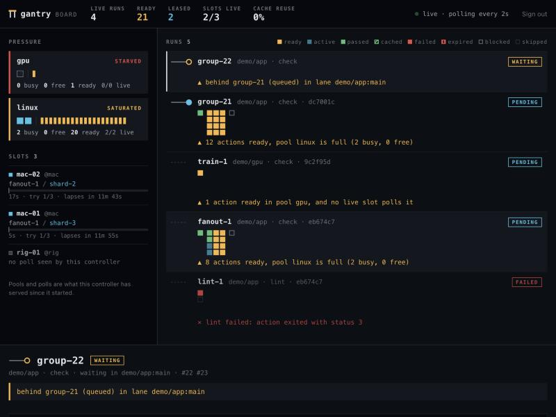
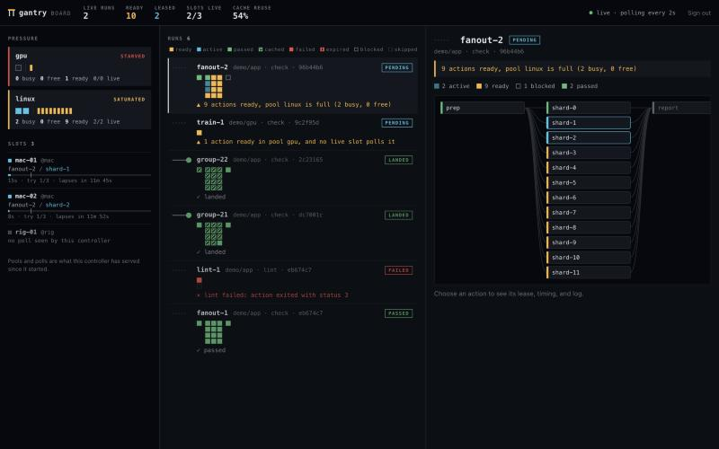
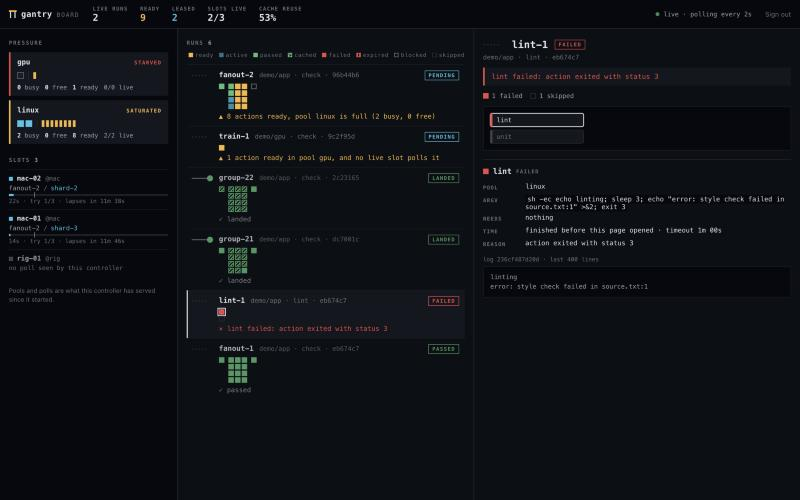
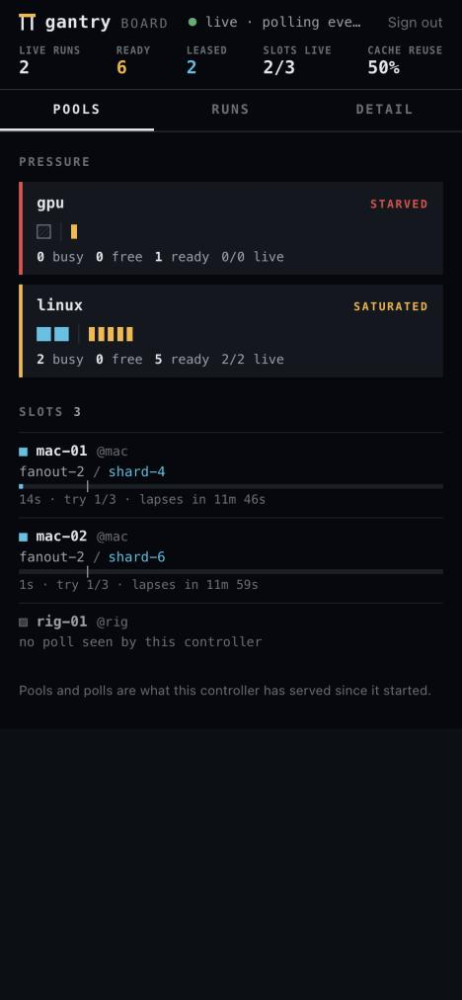
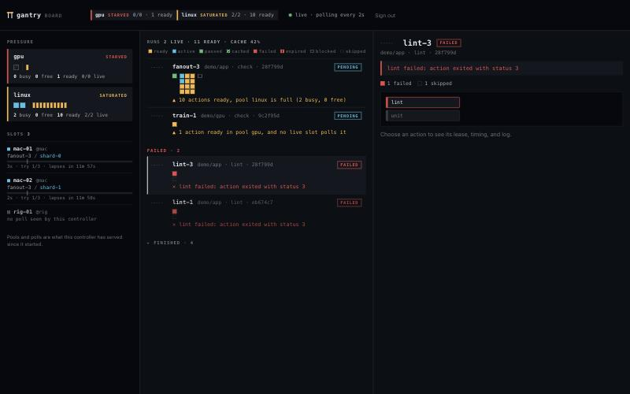
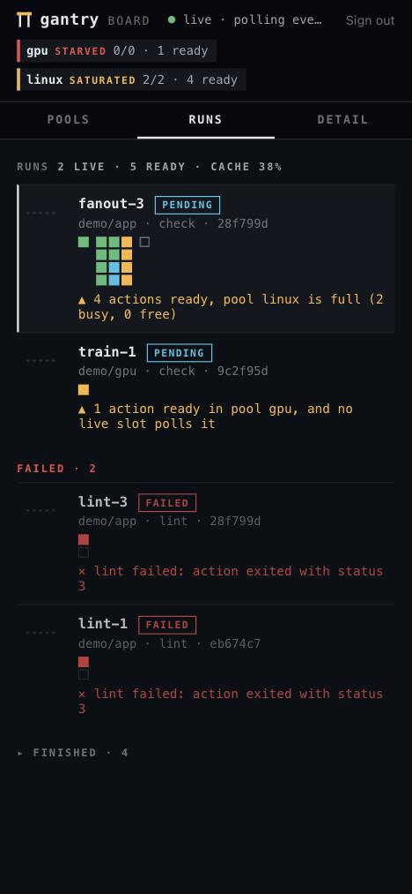

# Dashboard: the pressure board

**Status:** built on branch `dashboard`, not merged. Two design councils
ruled on it, and the rulings, the dissent, and the screenshots are below.

## The question

Someone looking at the dashboard should be able to tell, at a glance, whether
the fleet is saturated and why a run is stuck. The dashboard shows live runs
with each action's state, which slot and host holds each lease, how busy
each pool is, the landing state of groups, and each action's log, timing,
and cache use. It is a Lustre application, built the way Loom builds its web
client.

## What the controller could already say, and what it could not

Before this work the API served one run by ID (`GET /v1/runs/{id}`) and
nothing else to read. A dashboard needed three more things:

| Need | Built | How |
| --- | --- | --- |
| Every run at once | `GET /v1/fleet` | Every retained run, encoded by `protocol.encode_run` |
| Which slots exist and what they serve | `slots` in the snapshot | The `[[worker]]` entries, each with the latest poll that this controller served, held in an ETS table (`gantry_presence_ffi.erl`) |
| A host for each slot | Optional `host` label on `[[worker]]` | A lease names only a worker ID, so a host label is the operator's to give |
| A read-only credential for a browser | Optional `GANTRY_VIEW_TOKEN` | Reads status, the snapshot, and blobs, and cannot admit work |
| A push stream | Not built | `EventSource` cannot send an `Authorization` header, so the page polls every 2 s, which is as often as an idle worker polls |

The snapshot's types live in `gantry_core/fleet`, which both the controller
and the dashboard compile, so the encoder and the decoder are one module.
The decoder is total and refuses a negative clock, a repeated slot or run, or
an unknown presence tag. The routes are in the [API reference](../api.md#the-fleet-snapshot).

What the snapshot still cannot say, and what the page shows instead:

- **Step times.** Steps carry no timestamps. A lease's grant time follows
  from its deadline, which the core sets once to the grant time plus the
  timeout plus `queue.lease_slack` and never renews (`fleet.granted`). The page
  times a finished action only if it saw the action leased (`timing.observe`),
  to within one poll. An action that finished before the page opened says so.
- **Leased versus running.** No message marks the start of an action after
  its lease, so both appear as `active`.
- **Presence in a quorum.** Presence is per controller and in memory, because
  writing every idle poll to the replicated queue would replicate the poll
  rate. In a three-voter quorum a slot that polls another voter reads as
  "no poll seen by this controller" on this one. Its leases still show,
  because leases are queue state.

## Directions considered

Three directions went to the first council, each described at the same
length:

1. **Switchyard.** Each repository lane is a rail track. A run is a train of
   action cars, and a coupling line joins each leased car to the siding of
   the slot that holds it.
2. **Slot timeline.** One swimlane per slot with lease bars on a live time
   axis, and a run table below.
3. **Pressure board.** A rail with one gauge per pool (ready actions against
   busy and free slots, with a verdict) and one row per slot. Next to it, the
   run list with each run's graph as a strip of state cells and one computed
   diagnosis line. A detail pane shows the chosen run's graph, action, lease,
   and log.

## First council: which direction

Three seats, each blind to the others and each assigned one lens (clarity
under load, operator workflow, visual distinctiveness), then a judge.

**Ruling: the pressure board, unanimous.** Saturation is a comparison of
demand with supply for each pool, and only this layout puts the two numbers
side by side with a verdict. Only this layout says on each run row why the
run is stuck. The diagnosis needs nothing the controller lacks except the
per-controller poll record.

Every seat verified a flaw in each alternative. The timeline's main canvas
needs step start and finish times the controller does not record, so a busy
fleet would look idle after a page load. The switchyard promised a host on
each coupling line when a lease names only a worker. It also drew `expired`
as a state of its own, but the core records an expiry as
`Failed(LeaseExpired(_))`, and with thirty trains the coupling lines would
cross.

**Dissent and conditions.** The workflow and distinctiveness seats ranked the
switchyard second. The distinctiveness seat warned that a three-pane layout
drifts toward an admin template if the run list becomes a plain table with
badges, so it asked that the cell strips and a track-and-signal lane glyph be
treated as required. The clarity seat warned that a wrong diagnosis misleads
more than a missing one, so each diagnosis names its evidence ("pool linux
is full (2 busy, 0 free)"), not a bare conclusion. The judge would revisit
the ruling if real runs turn out to be mostly short chains, or if the
controller starts recording step times, which would make a timeline worth a
second tab.

**Folded in from the other directions:** the switchyard's track and signal,
as each run's lane glyph (the signal's colour is the group's landing state);
the timeline's deadline tick, on each slot's lease bar.

## The first build

From a local controller with two slots in pool `linux`, a registered slot
`rig-01` that never polled, a `gpu` repository that no slot serves, a
12-shard fan-out, a failing `lint` target, and two groups in one lane:

`fanout-2` ten seconds apart at 1440 px, with no reload between them.
`shard-0` passed, `shard-2` took its slot, and ready work fell from 10 to 9:

A failed action with its lease facts and log tail:

At 390 px, the Runs and Pools tabs:

## Second council: what to refine

The seats read the screenshots above and weighed three options: ship the
first build as it is; add a **ribbon** of pool verdict chips to the header
and fold finished runs; or group the run list by repository **lane**.

**Ruling: the ribbon, amended (not unanimous).**

- **Chips replace the totals.** At 390 px the Runs tab showed only fleet
  totals, so nothing on screen said which pool was saturated. One chip per
  pool now takes the place of the totals row, drawn like the rail cards
  (verdict bar, name, verdict, busy over live, ready), and busy or idle pools
  are muted. The header does not grow. The live count and the cache rate
  moved to the Runs title.
- **Three bands.** The run list is live runs, then failed ones, then a folded
  "Finished" band. The ribbon as proposed folded failed runs too. The judge
  verified (`board.live` is false for `Broken`) that this would hide the
  failures an operator most needs, so only settled runs fold.
- **A failed run opens on its failure.** Choosing a broken run selects its
  first failed action and fetches the log, which saves a step on a phone.

**Dissent.** The clarity seat picked the ribbon as written, keeping the
totals and adding the chips as a row. The workflow and distinctiveness seats
wrote in the amended form. No seat ranked lanes first. The distinctiveness
seat ranked it above shipping for its railway look, but only if deployments
run many repositories and branches. The judge would fall back to chips as
their own row if operators turn out to rely on the fleet totals, or if
fleets run more than four or five pools, so the chips no longer fit at
390 px. The judge would consider lanes if head-of-line blocking within a
lane, not pool capacity, turns out to be the usual cause of a stall. If
failed runs pile up into the tens, the failed band should show only recent
ones.

## How it is built

- `packages/dashboard` is a Lustre 5.7.1 application on the JavaScript
  target, pinned to the versions Loom's `web_client` uses. Every decision is
  in modules that import no Lustre: `board` for cells, layers, pool verdicts,
  slot occupation and diagnoses, `model` for the page's transitions, `timing`
  for durations the page observed, and `layout` for the graph's positions.
  Their tests run under Node without a page, which is Loom's split.
- `scripts/dashboard_assets.sh` bundles the package with `lustre_dev_tools`
  into `packages/server/priv/ui` and stamps each input's digest and the
  body's into the bundle. The `--check` mode in `make check` recomputes them,
  so a stale or hand-edited bundle fails without a toolchain or the network.
  It follows the shape of Loom's `scripts/web_assets.sh`. The stylesheet is
  plain CSS, not Tailwind, so the build downloads only Lustre's Bun.
- `gantry/ui` serves three fixed names under `/ui` with a content security
  policy that allows only same-origin scripts, styles, and requests. Inline
  style attributes are allowed because lease bars and strip columns are sized
  per element.
- The page holds its token in local storage and sends it only to its own
  origin. A 401 signs it out. Any other error keeps the last board on screen
  and marks it stale.

## Open

- **Step timestamps.** Recording when an action was leased and finished in
  the queue image would give real durations, and would make a slot timeline
  worth adding as a second view. That is a change to the durable format and
  to the model, so it needs its own proposal.
- **Presence across voters.** Replicating presence would cost a Ra write per
  idle poll. A cheaper route is for each voter to answer `GET /v1/fleet` with
  presence it collects from its peers on request.
- **A push stream.** Polling every 2 s suits the scale here. A stream would
  need cookie or ticket authentication, because `EventSource` cannot set a
  header.
- **Live fleet.** The board has run only against a local controller. Pointing
  it at the live fleet needs `GANTRY_VIEW_TOKEN` and `host` labels in that
  fleet's `controller.toml`, and the user's go-ahead.
